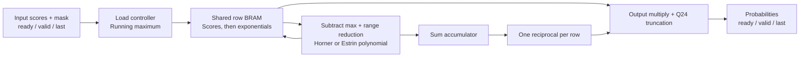

# Fixed-Point Softmax RTL Accelerator

A SystemVerilog Softmax accelerator with Horner and Estrin polynomial evaluation,
a shared reciprocal unit, and BRAM-based buffering for sequences up to **16,384 entries**.
Built as an RTL design, verification, and FPGA implementation project.

**Recorded Estrin implementation:** 483 LUTs, 325 flip-flops, 7 DSP blocks,
12 RAMB36 + 1 RAMB18; positive internal setup and hold slack at a 200 MHz constraint.

## Architecture



The controller sequences `LOAD -> EXPONENTS -> RECIPROCAL -> EMIT` with setup/wait states.
One arithmetic lane processes the row over time. The next row does not overlap with
output emission. This is a standalone operator, not a complete Transformer or a
systolic-array-sharing implementation.

## Measured implementation

Vivado **2024.2**, `xczu7ev-ffvf1517-3-e`, `MODE=1`, `MAX_LEN=16384`, 5 ns clock.
The table compares the earlier LUTRAM design with the BRAM revision after routing.

| Metric | Earlier LUTRAM buffer | BRAM buffer |
|---|---:|---:|
| LUTs | 10,801 | **483** |
| Flip-flops | 581 | **325** |
| DSP blocks | 7 | **7** |
| RAMB36 / RAMB18 | 0 / 0 | **12 / 1** |
| Setup WNS | +1.149 ns | **+0.438 ns** |
| Hold WHS | +0.027 ns | **+0.028 ns** |

The **95.5% LUT reduction** came from memory mapping, not a 95.5% reduction in total
hardware area. BRAM is a separate resource. Current TNS and THS are zero.

**Timing scope:** only internal clocked paths are covered by the 200 MHz claim.
The report has 21 inputs and 29 outputs without delay constraints. Board pins and
I/O standards are unspecified, and DSP pipelining warnings remain. This is a routed
core study, not a board-validated or bitstream-ready design. See
[results and limitations](docs/RESULTS.md) and [report evidence](docs/results/).
No measured power or energy saving is claimed.

## Verification

Both modes passed XSim against the Python fixed-point model: **22 rows and 67,587
output checks per mode**, including 16,384-entry rows. Tests cover masks, all-masked
rows, extreme scores, uniform and random rows, forced capacity termination,
input gaps, output backpressure, and reset during loading.

The Python reference also compares with floating-point Softmax on the **same
quantized input scores**. This does not measure BERT/Qwen accuracy or errors from
quantizing original floating-point model scores.

| Error metric | Horner | Estrin |
|---|---:|---:|
| Max exponential absolute error, all 65,536 differences | 6.4492e-5 | 6.4301e-5 |
| Max probability absolute error, tested rows | 1.5686e-5 | 1.5865e-5 |
| Max deviation of output sum from 1, active tested rows | 3.0226e-4 | 3.0553e-4 |

These are measured maxima for the stated tests, not universal bounds.
Horner and Estrin use different intermediate truncation, so each has its own golden outputs.

## Run the project

Requirements: Python 3 (standard library only), Vivado 2024.2 with the selected
device installed and licensed, and XSim. XPM memory comes from Vivado; vendor
library sources are not bundled.

1. Extract or clone the repository. Keep its directory structure.
2. From a terminal in the repository root, regenerate and validate the reference:

```sh
python scripts/generate_vectors.py
```

3. In the Vivado Tcl console, with any unrelated project closed, use your extraction path:

```tcl
set SM_MODE 1
set SM_MAX_LEN 16384
set SM_PART xczu7ev-ffvf1517-3-e
source {C:/path/to/softmax-rtl-accelerator/vivado/create_project.tcl}
source [file join $sm_root vivado run_sim.tcl]
```

Require `ALL SOFTMAX RTL TESTS PASSED`. The simulation script checks the fresh log
and rejects fatal errors; completion of XSim alone is not a test pass.

4. After simulation passes:

```tcl
source [file join $sm_root vivado run_synth.tcl]
source [file join $sm_root vivado run_impl.tcl]
```

Generated results go under `reports/mode1_n16384/`; curated historical results
remain under `docs/results/`. Rebuilding resets this project's previous runs.

To synthesize Horner, set `SM_MODE 0`, source `create_project.tcl` again, then run
simulation, synthesis, and implementation again. The testbench always instantiates
both modes at capacity 16,384; changing synthesis parameters does not automatically
validate every configuration. Do not edit RTL between verification and synthesis.

## Interface

| Signal | Meaning |
|---|---|
| `clk`, `rst` | Rising-edge clock, synchronous active-high reset |
| `in_valid`, `in_ready` | Input accepted when both are high |
| `in_score[15:0]` | Signed fixed-point score, real value = raw / 256 |
| `in_mask` | 1 excludes this entry; output remains in sequence and equals zero |
| `in_last` | Last input of a row |
| `out_valid`, `out_ready` | Output transferred when both are high |
| `out_probability[24:0]` | Unsigned probability, real value = raw / 2^24 |
| `out_last` | Last output of the row |
| `out_error` | Valid with `out_valid`; all-masked row or missing `in_last` at capacity |

Inputs must remain stable while valid and stalled; outputs remain stable under
backpressure. Reset discards an unfinished row. An all-masked row returns zeros.
If `in_last` is absent at capacity, the core terminates that row and flags an error.
There is no AXI, DMA, or external model interface.

## Repository layout

```text
rtl/          Synthesizable operator, polynomial, exponent and reciprocal units
sim/          Testbench and reproducible golden vectors
scripts/      Python fixed-point reference and vector generator
vivado/       Project creation, simulation, synthesis and routing Tcl
constraints/  5 ns internal clock constraint
docs/         Arithmetic description, results, limitations and sanitized reports
```

See [arithmetic and dataflow](docs/ARCHITECTURE.md) for the fixed-point equations.
Future experiments include fair resource/throughput comparisons between schedules,
precision reduction, model-level quality evaluation, and board integration.
This project does not claim a new polynomial algorithm or superiority over published accelerators.
